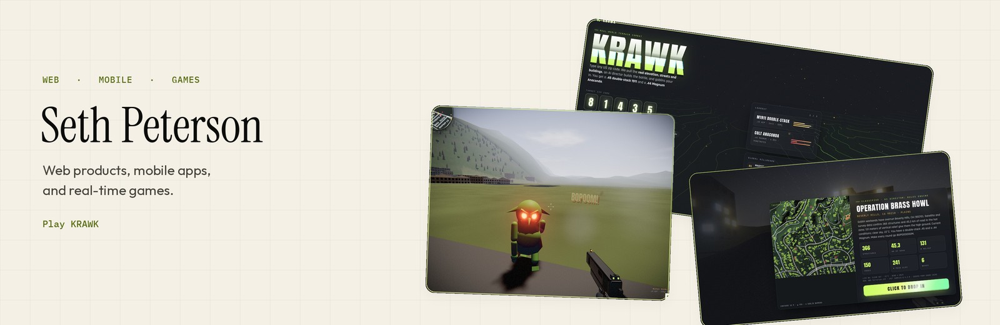

<a href="https://krawkpeterson.github.io/GoblinShooter/">
  <picture>
    <source media="(prefers-color-scheme: dark)" srcset="./assets/banner-dark.jpg"/>
    <source media="(prefers-color-scheme: light)" srcset="./assets/banner-light.jpg"/>
    
  </picture>
</a>

  <a href="https://krawkpeterson.github.io/GoblinShooter/">Play KRAWK</a> ·
  <a href="https://github.com/krawkpeterson/SolarForge">SolarForge</a> ·
  <a href="https://github.com/krawkpeterson/GoblinShooter">Source</a> ·
  <a href="https://www.krawkdev.com">krawkdev.com</a>

Type a zip code. The map is the real ground: elevation, streets, buildings, and the weather outside. Then the goblins show up.

SolarForge is the other build. The same calculation engine runs on the web and in the Expo app, for a solar system you can check before you buy the hardware.

## Selected work

<table>
  <tr>
    <td width="50%" valign="top">
      
      <h3><a href="./projects/krawk.md">KRAWK</a></h3>
      
Your zip code. Their graveyard. A browser FPS on real terrain, two guns synthesized from scratch, and a drill sergeant who grades you. It runs in the tab.

      
Live · TypeScript, Three.js, Web Audio

    </td>
    <td width="50%" valign="top">
      
      <h3><a href="./projects/solarforge.md">SolarForge</a></h3>
      
Planning for grid-tied, hybrid, off-grid, cabin, and van systems. Array, battery, string voltage, shading, and a payback band. Estimates, not a permit set.

      
TypeScript · Next.js · Expo · one shared engine

    </td>
  </tr>
</table>

## Get in touch

The fight is live in the browser: [Play KRAWK](https://krawkpeterson.github.io/GoblinShooter/). The rest of the work is in the repos, and at [krawkdev.com](https://www.krawkdev.com).
