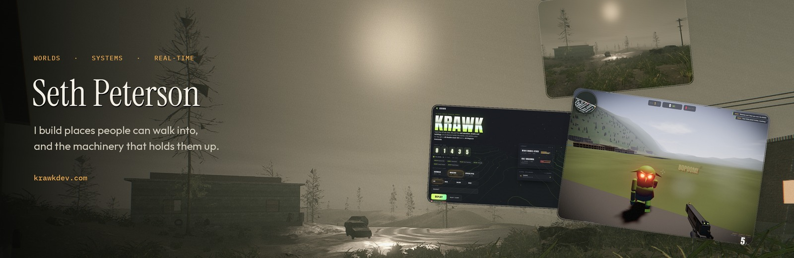
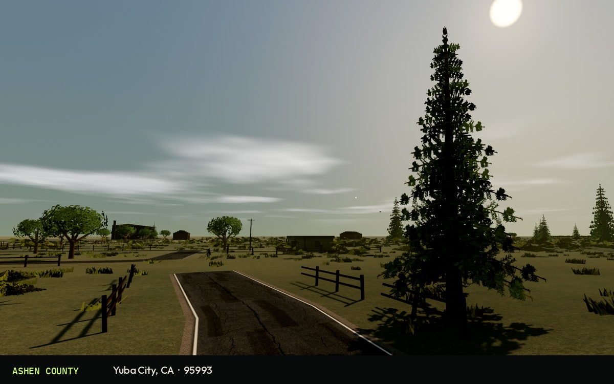
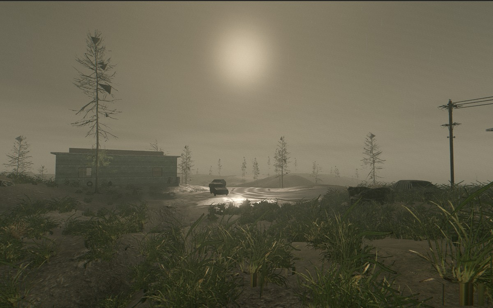
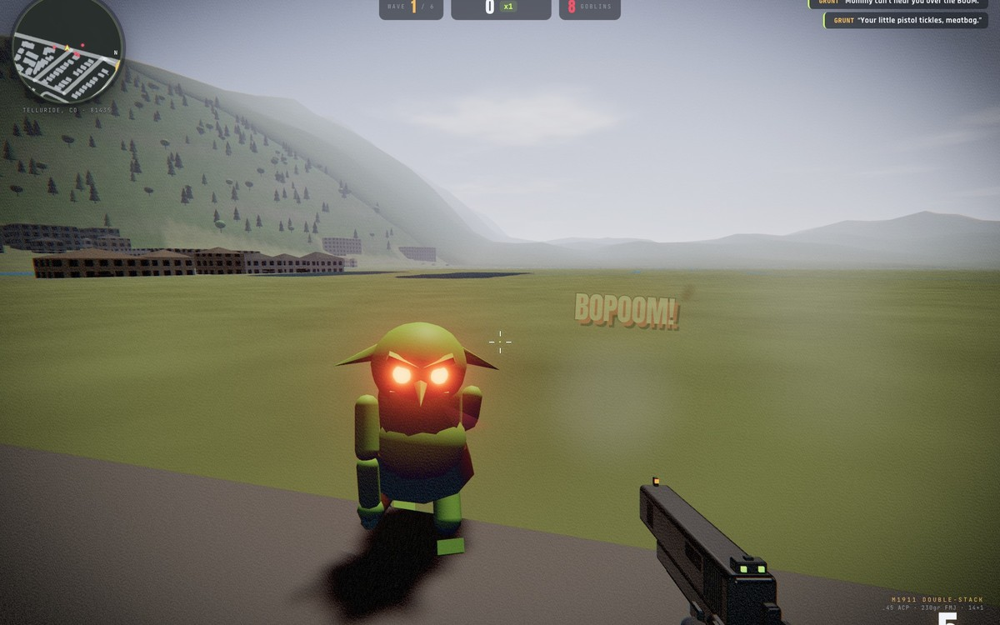

<a href="https://www.krawkpeterson.com">
  <picture>
    <source media="(prefers-color-scheme: dark)" srcset="./assets/banner-dark.jpg"/>
    <source media="(prefers-color-scheme: light)" srcset="./assets/banner-light.jpg"/>
    
  </picture>
</a>

  <a href="https://www.krawkpeterson.com">krawkpeterson.com</a>
  &nbsp;·&nbsp;
  <a href="https://github.com/krawkpeterson/ZIP-Code-World-Generator">Ashen County</a>
  &nbsp;·&nbsp;
  <a href="https://github.com/krawkpeterson/SurvivalHorror">Blackbriar</a>
  &nbsp;·&nbsp;
  <a href="https://krawkpeterson.github.io/GoblinShooter/">Play KRAWK</a>

  Real-time games · Procedural worlds · Finished to a tolerance you can feel

 

## Selected work

<table>
  <tr>
    <td width="50%" valign="top">
      
      <h3><a href="./projects/ashen-county.md">Ashen County</a></h3>
      
Type a US ZIP. Get a walkable county — real elevation, OSM roads and buildings, aerial tint, and a place you recognize without a 1:1 replica.

      
Godot 4.7 · Forward+ · Terrarium · OpenStreetMap · USGS

    </td>
    <td width="50%" valign="top">
      
      <h3><a href="./projects/blackbriar.md">Blackbriar</a></h3>
      
Procedural survival horror. Seeded terrain, overgrown settlements, weather, and a hollow that keeps what it grows.

      
In progress · GDScript · Forward+

    </td>
  </tr>
  <tr>
    <td colspan="2" valign="top">
      
      <h3><a href="./projects/krawk.md">KRAWK</a></h3>
      
Your zip code. Their graveyard. A browser FPS on real terrain, two guns synthesized from scratch, and a drill sergeant who grades you. It runs in the tab.

      
Live · TypeScript · Three.js · Web Audio · <a href="https://krawkpeterson.github.io/GoblinShooter/">Play</a> · <a href="https://github.com/krawkpeterson/GoblinShooter">Source</a>

    </td>
  </tr>
</table>

 

## Get in touch

Building something with real terrain, browsers, or a world that has to regenerate — start at [krawkpeterson.com](https://www.krawkpeterson.com).
