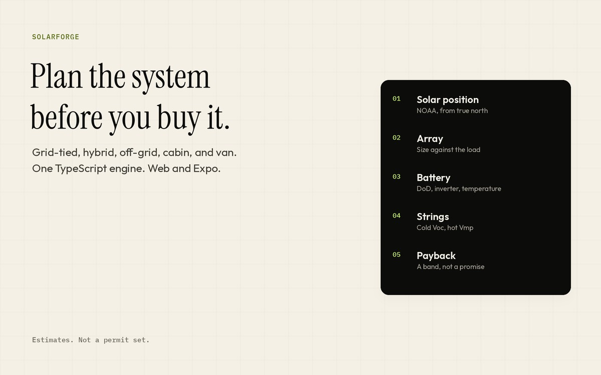

# SolarForge

A planning app for grid-tied, hybrid, off-grid, cabin, and van solar systems. The same TypeScript calculation engine runs on the web and in the Expo app.

It covers NOAA solar position (azimuth clockwise from true north), array sizing, battery sizing, string-voltage checks, shading geometry, and a payback band. Projects can live in the browser. Accounts, NREL PVWatts, and a text PDF report are there when you run the stack locally.

These are estimates. They are not an engineering stamp, a permit set, or a substitute for the electrical code where you build.

[Source](https://github.com/krawkpeterson/SolarForge)
